<div align="center">
  <picture>
    <source media="(prefers-color-scheme: dark)" srcset="./dark.svg" />
    <source media="(prefers-color-scheme: light)" srcset="./light.svg" />
    
  </picture>
</div>

<p align="center">
  <a href="https://github.com/avinashreddych21">
    
  </a>
</p>

---

### 💻 Executive Overview

```yaml
identity:
  name: Avinash Reddy
  degree: B.Tech in Computer Science & Engineering
  institution: SRM University AP
  status: Active // Undergrad
technical_focus:
  - Machine Learning & Data Science
  - Full-Stack Web Development
  - Scalable Software Architectures
operating_principles:
  - "Write modular, clean, and maintainable code"
  - "Design systems driven by data and algorithmic efficiency"
  - "Continuously learn, implement, and ship"
```

I am a Computer Science undergraduate at **SRM University AP** focused on software engineering, machine learning pipelines, and responsive full-stack applications. I enjoy architecting systems that blend robust backend logic with intelligent algorithms and intuitive user interfaces.

---

### 🚀 Selected Engineering Projects

| Project | Domain | Key Architecture & Tech | Repository |
| :--- | :--- | :--- | :---: |
| 📊 **Hybrid Recommendation System** | Machine Learning & Data Science | Multi-model recommender integrating collaborative filtering & content-based algorithms with behavioral telemetry flow and analytical reporting. | [Repository](https://github.com/avinashreddych21) |
| ⏰ **Ananta — The Clock** | Web Engineering & UI | High-precision interactive web clock and utility tool featuring modern visual styling and clean responsive event loops. | [Source Code](https://github.com/avinashreddych21/Ananta---The-Clock) |
| 🛒 **Shopez Web Platform** | Full-Stack Web Development | Dynamic web store featuring product catalogs, state-managed shopping carts, and structured navigation. | [Repository](https://github.com/avinashreddych21) |

---

### 🛠️ Technical Stack & Tooling

#### Languages & Core Technologies
<p align="left">
  
  
  
  
  
  
  
  
</p>

#### Machine Learning & Scientific Computing
<p align="left">
  
  
  
  
</p>

#### Frameworks & Data Persistence
<p align="left">
  
  
  
</p>

#### Development Environment & Tooling
<p align="left">
  
  
  
  
  
</p>

---

### 📊 GitHub Activity & Telemetry

<p align="center">
  
  
</p>

<p align="center">
  
</p>

---

### 🌐 Connect Protocols

<p align="center">
  <a href="https://github.com/avinashreddych21" target="_blank">
    
  </a>
  &nbsp;
  <a href="https://www.linkedin.com/in/avinash-reddy-b5ba6833a/" target="_blank">
    
  </a>
  &nbsp;
  <a href="mailto:avinashreddych2006@gmail.com" target="_blank">
    
  </a>
</p>

<p align="center">
  ⭐️ <i>Engineered with passion. Continuous integration, continuous deployment.</i>
</p>
