  <!-- Autonomous Cybernetic Hero Banner -->
  

    

  <!-- Quick Transmission Protocols & Direct Links -->
  
  &nbsp;
  
  &nbsp;
  

    

  <!-- Hardware Telemetry Counters -->
  
  &nbsp;
  
  &nbsp;
  

 

---

### ⚡ Core Engineering & Operating System

> **Computer Science & Engineering undergraduate at SRM University, Amaravati (Current CGPA: 9.1 / 10).** Strong foundation in **Object-Oriented Programming (OOP)**, **Data Structures & Algorithms (DSA)**, and **Full-Stack Web Development**. Proficient in **C, C++, Python, JavaScript, and PHP/MySQL**, with proven experience designing modular console utilities, database-driven web platforms, and solving algorithmic problems with high computational efficiency.

 

---

### 🚀 Verified Projects & Deployments

| Project | System Architecture & Capabilities | Core Stack | Links |
| :--- | :--- | :--- | :---: |
| **🛒 ShopEZ E-Commerce Platform** | Full-scale e-commerce web platform engineered with reactive product catalogs, local storage cart states, and seamless checkout flows | `JavaScript` `HTML5` `CSS3` | [Repository ↗](https://github.com/avinashreddych21/ShopEZ-E-COMMERCE-PLATFORM) |
| **📊 Student Record Management System** | Responsive academic platform featuring Chart.js analytics dashboard, CRUD student directory, automated CGPA calculations, section capacity checks, and Excel export | `JavaScript` `Tailwind CSS` `Chart.js` | [Repository ↗](https://github.com/avinashreddych21/SRMS-Student-Record-Management-System-Project) |
| **⏰ Ananta — The Clock** | Interactive modern digital clock, precision scheduling timer, and productivity interface with fluid UI event synchronization | `Python` `JavaScript` `CSS3` | [Repository ↗](https://github.com/avinashreddych21/Ananta-The-Clock) |
| **🔄 Circular Queue Simulation** | Interactive visualization for Linear & Circular Queues with real-time UI controls for Enqueue/Dequeue operations, dynamic index tracking, and C++ logic | `C++` `JavaScript` `Algorithms` | [Repository ↗](https://github.com/avinashreddych21/Circular-Queue-Data-Structure-Simulation) |

 

---

### 🛠️ Technical Stack & Tooling Matrix (from Resume)

  
  &nbsp;
  
  &nbsp;
  
  &nbsp;
  
  &nbsp;
  
  &nbsp;
  
  &nbsp;
  
  &nbsp;
  
  &nbsp;
  
  &nbsp;
  
  &nbsp;
  

 

| Technical Domain | Tools & Core Competencies |
| :--- | :--- |
| **Programming Languages** | C, C++, Python, JavaScript (ESNext), PHP |
| **Web Development** | HTML5, CSS3, Bootstrap, JavaScript, PHP, Responsive Design |
| **Databases** | MySQL, Database Management Systems (DBMS), MongoDB (Basics) |
| **Core Competencies** | Data Structures & Algorithms (DSA), Object-Oriented Programming (OOP), Problem Solving |

 

---

### 📈 Real-Time GitHub Telemetry

  
  &nbsp;&nbsp;
  

 

<!-- Interactive Quantum Contribution Grid Snake -->

  <picture>
    <source media="(prefers-color-scheme: dark)" srcset="https://raw.githubusercontent.com/avinashreddych21/avinashreddych21/output/github-contribution-grid-snake-dark.svg">
    <source media="(prefers-color-scheme: light)" srcset="https://raw.githubusercontent.com/avinashreddych21/avinashreddych21/output/github-contribution-grid-snake.svg">
    
  </picture>

 

---

   
  
<b>Let's engineer something meaningful together.</b>

  <a href="https://www.linkedin.com/in/avinash-reddy-b5ba6833a/" target="_blank"><b>Connect on LinkedIn ↗</b></a> &nbsp;&bull;&nbsp;
  <a href="mailto:avinash_chinthalacheruvu@srmap.edu.in"><b>Academic Email ↗</b></a> &nbsp;&bull;&nbsp;
  <a href="https://github.com/avinashreddych21" target="_blank"><b>Explore Repositories ↗</b></a>
    
  <code>SYS.ARCH // SRM UNIVERSITY AMARAVATI (CGPA: 9.1/10) // ARCHITECTED &amp; CRAFTED BY AVINASH REDDY</code>
    

